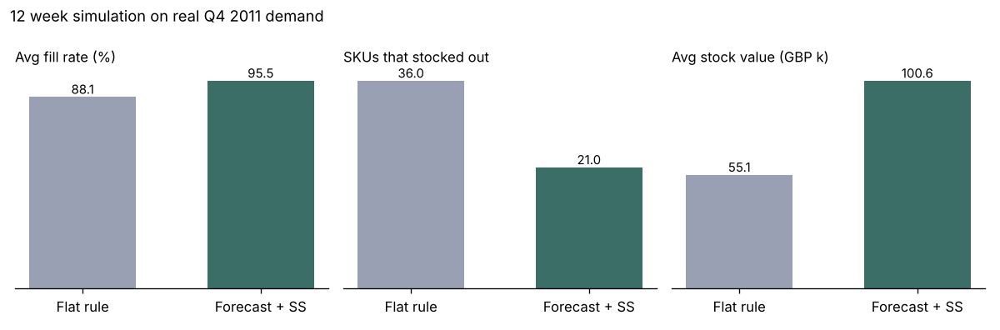
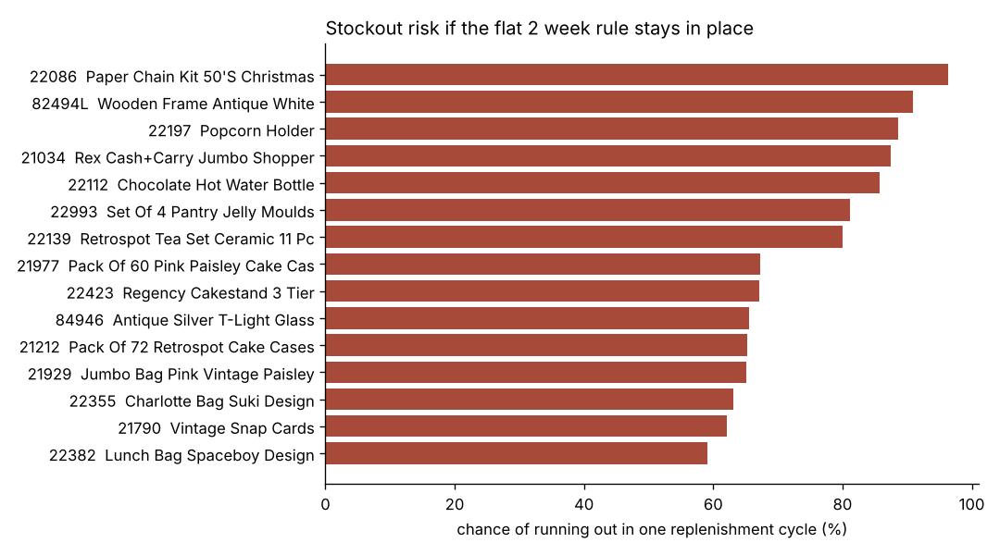
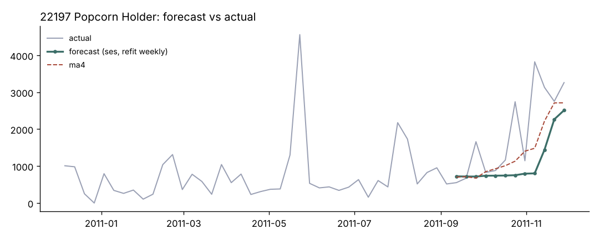

# Inventory Demand Forecasting + Reorder Points

Forecasting weekly demand for 50 fast moving SKUs at a UK gift wholesaler, then using those forecasts to set safety stock and reorder points, and checking whether that actually beats a simple "reorder when you're down to 2 weeks of stock" rule.

I picked this because it's basically the problem I kept running into at Action Air (procurement and inventory) and at DHL (warehouse ops). In both places reorder decisions leaned on a flat rule of thumb, and it worked fine until demand moved. I wanted to put real numbers on how much a forecast driven reorder point helps, and what it costs in extra stock.

## Data

[UCI Online Retail](https://archive.ics.uci.edu/dataset/352/online+retail). 541,909 invoice lines from a UK based online wholesaler of giftware, Dec 2010 to Dec 2011. Most customers are small shops buying in bulk, so orders are lumpy.

`python get_data.py` downloads it. The cleaned weekly demand for the 50 SKUs I modeled is already committed in `data/weekly_demand_top50.csv`.

What there is: invoices, SKU, quantity, price, date, customer.
What there isn't: on hand inventory, lead times, purchase orders. So the inventory side of this runs on assumptions I state below.

## What I did

1. **Cleaning.** Netted cancellations back against demand instead of just dropping the "C" invoices. This matters more than it sounds: one cancelled order was 80,995 units of a single SKU, and another was 74,215. Leave those in and the forecast for those items is junk. Also dropped warehouse adjustments (negative qty with zero price), postage/fees/vouchers, and the partial first and last weeks.
2. **ABC / XYZ** on all 3,791 products with sales. ABC by revenue (80/15/5), XYZ by how volatile weekly demand is.
3. **Picked 50 SKUs.** Most ordered items that sold in at least 40 of 52 weeks. These are the steady movers you'd actually set reorder points for. 49 of the 50 are A items.
4. **Forecasting.** Compared naive, 4 and 8 week moving averages, simple exponential smoothing (SES), and damped Holt. Rolling one step ahead backtest, refit every week, the way it would run every Monday. Split was 28 weeks train, 12 weeks validation (to pick a model per SKU), 12 weeks test (mid Sep to early Dec 2011).
5. **Safety stock + reorder points.** `SS = z * forecast RMSE * sqrt(lead time)` and `ROP = forecast * lead time + SS`.
6. **Simulation.** Replayed the real Q4 demand through two policies with the same starting stock:
   * **Flat rule:** reorder when stock + on order drops below 2 weeks of the trailing quarter's average. Order 4 weeks' worth.
   * **Forecast + SS:** reorder point moves every week with the forecast, plus safety stock.

## Assumptions

| | |
|---|---|
| Supplier lead time | 2 weeks |
| Review | weekly |
| Target cycle service level | 95% (z = 1.645) |
| Order size | ~4 weeks of demand |
| Unmet demand | lost (wholesale buyers go elsewhere) |

All in `src/inventory.py` if you want to change them.

## Results

**Forecast accuracy (test weeks, WAPE, lower is better)**

| Method | WAPE | Bias |
|---|---|---|
| SES | 0.415 | -7.0% |
| 8 week MA | 0.424 | -5.2% |
| 4 week MA | 0.433 | -5.2% |
| Damped Holt | 0.435 | -2.7% |
| Best model picked per SKU | 0.444 | -4.8% |
| Naive | 0.524 | -1.8% |

The thing I didn't expect: picking the "best" model for each SKU on the validation weeks did worse than just using SES everywhere. 12 weeks is not enough to tell models apart per item, so the per SKU pick was mostly picking noise. The forward looking reorder points use SES for every SKU because of this.

Everything under forecasts a bit (negative bias) because demand in the test weeks ran about 42% above the rest of the year, and every one of these methods lags a ramp.

**Policy simulation, 12 weeks of real Q4 demand**

| | Flat 2 week rule | Forecast + safety stock |
|---|---|---|
| Avg fill rate | 88.1% | 95.5% |
| SKUs that stocked out at least once | 36 of 50 | 21 of 50 |
| Units short | 35,343 | 14,009 |
| Avg stock value on hand | ~£55k | ~£101k |



So the forecast policy cut lost units by about 60% and got close to the 95% target. But it isn't free: it carried roughly 1.8x the stock value. Whether that's worth it depends on margin and carrying cost, which this dataset doesn't have. If I had to defend this to a buyer I'd say: use it on the A items going into Q4, and drop the service level target for the slower stuff.

**Who's most at risk right now**

`outputs/reorder_points.csv` has the forecast, safety stock, and reorder point for all 50 SKUs, plus the chance of running out during one lead time if they stayed on the flat rule. 30 of the 50 are above 50%. The Christmas paper chain kit is the worst (96%): its flat rule reorder point is 2,107 units, the forecast based one is 4,270.





This one shows the problem with SES in a ramp pretty clearly. It sits flat through October and only catches up after demand has already jumped.

## Limitations / what I'd do next

* One year of data means no seasonal model. With a second year I'd add a Q4 seasonal index, which would fix most of that lag.
* Lead time is assumed, not measured. In a real setting I'd pull actual PO to receipt dates and use lead time variability in the safety stock formula too.
* Fill rate here is per SKU averaged, not weighted by revenue.
* XYZ came out almost all Y and Z (only 5 X items in the whole catalog). Weekly demand at a wholesaler is just lumpy. For the long tail of Z items I'd look at Croston's method instead of what's here.

## Run it

```
pip install -r requirements.txt
python get_data.py
python run_pipeline.py
```

Writes CSVs and charts to `outputs/`. `notebooks/walkthrough.ipynb` goes through the same steps with tables shown.

```
├── get_data.py
├── run_pipeline.py
├── src/
│   ├── prep.py         cleaning, weekly demand, SKU selection
│   ├── forecast.py     models + rolling backtest
│   └── inventory.py    ABC/XYZ, safety stock, ROP, simulation
├── notebooks/walkthrough.ipynb
├── data/weekly_demand_top50.csv
└── outputs/
    ├── reorder_points.csv
    ├── forecast_accuracy.csv
    ├── policy_simulation.csv
    ├── abc_xyz_all_skus.csv
    ├── summary.txt
    └── charts/
```

Python, pandas, statsmodels, scipy, matplotlib.
